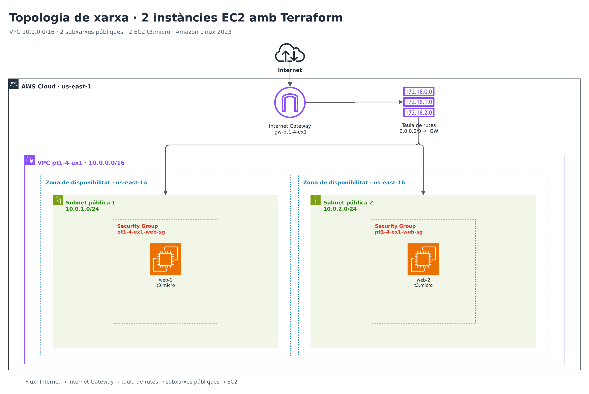

# Exercici 1 — Primeres instàncies EC2 amb Terraform

## Objectiu

Iniciar-se en la Infraestructura com a Codi (IaC) amb Terraform, definint i
desplegant dos servidors EC2 a AWS de manera reproduïble, versionada i
automatitzada.

## Descripció

Aquest projecte crea **2 instàncies EC2 `t3.micro`** amb **Amazon Linux 2023**
a la regió **`us-east-1`**, dins d'una VPC pròpia amb dues subxarxes públiques
en zones de disponibilitat diferents.

Les instàncies executen Apache HTTP Server i mostren una pàgina web que
identifica la instància, de manera que es pot comprovar fàcilment que el
desplegament ha funcionat.


## Topologia de xarxa



> El diagrama s'ha dissenyat amb draw.io i les formes oficials d'AWS. El fitxer editable és
> [`assets/topologia.drawio`](assets/topologia.drawio) i la imatge exportada és
> [`assets/topologia.png`](assets/topologia.png).

### Elements de la topologia

| Element | Configuració | Funció |
|---|---|---|
| Regió AWS | `us-east-1` | Ubicació de tots els recursos |
| VPC | `10.0.0.0/16` | Xarxa aïllada de l'exercici |
| Subxarxa pública 1 | `10.0.1.0/24` · `us-east-1a` | Xarxa on s'ubica `web-1` |
| Subxarxa pública 2 | `10.0.2.0/24` · `us-east-1b` | Xarxa on s'ubica `web-2` |
| Internet Gateway | `pt1-4-ex1-igw` | Sortida i entrada a Internet |
| Taula de rutes | `0.0.0.0/0 → IGW` | Encamina el tràfic públic |
| Security Group | `pt1-4-ex1-web-sg` | Permet HTTP (TCP 80) des d'Internet |
| EC2 `web-1` | `t3.micro` · Amazon Linux 2023 | Servidor web a `us-east-1a` |
| EC2 `web-2` | `t3.micro` · Amazon Linux 2023 | Servidor web a `us-east-1b` |

El flux de tràfic és:

```text
Internet → Internet Gateway → taula de rutes → subxarxa pública → EC2 (TCP 80)
```

Cada instància rep una **IP pública dinàmica** en el moment de la creació. Les
IPs i URLs resultants es poden consultar amb `terraform output`.

## Estructura del repositori

```text
practiquescloud/
└── pt1-4-ex1/
    ├── assets/
    │   ├── topologia.drawio
    │   └── topologia.png
    ├── README.md
    └── main.tf
```

## Requisits

- [Terraform](https://developer.hashicorp.com/terraform/install) `>= 1.6.0`
- Un compte d'AWS amb permisos per crear VPC, subxarxes, Security Groups i
  instàncies EC2
- Credencials d'AWS configurades, per exemple amb `aws configure` o les
  variables d'entorn `AWS_ACCESS_KEY_ID`, `AWS_SECRET_ACCESS_KEY` i
  `AWS_REGION`
- Opcionalment, AWS CLI per comprovar els recursos des de la consola

## Desplegament

Des de la carpeta `pt1-4-ex1`:

```bash
# 1. Inicialitza el projecte i descarrega el provider d'AWS
terraform init

# 2. Comprova el format i valida la configuració
terraform fmt -check
terraform validate

# 3. Revisa el pla abans de crear res
terraform plan -out=tfplan

# 4. Aplica el pla
terraform apply tfplan
```

En acabar, Terraform mostra els outputs. També es poden consultar amb:

```bash
terraform output
terraform output web_instances
```

Exemple de sortida:

```text
web_instances = {
  "web-1" = {
    "availability_zone" = "us-east-1a"
    "id"                = "i-0123456789abcdef0"
    "public_dns"        = "ec2-54-xx-xx-xx.compute-1.amazonaws.com"
    "public_ip"         = "54.xx.xx.xx"
    "subnet_id"         = "subnet-0123456789abcdef0"
    "url"               = "http://54.xx.xx.xx/"
  }
  "web-2" = {
    ...
  }
}
```

## Verificació

1. Copia la URL de cada instància a partir de `terraform output` i obre-la al
   navegador. Cada pàgina mostra el hostname de la instància i el sistema
   operatiu.
2. Comprova l'estat de les instàncies:

   ```bash
   terraform state show 'aws_instance.web[0]'
   terraform state show 'aws_instance.web[1]'
   ```

3. A la consola d'AWS, a **EC2 → Instances**, han d'aparèixer les dues
   instàncies amb l'etiqueta `Name` corresponent (`pt1-4-ex1-web-1` i
   `pt1-4-ex1-web-2`).

## Resultat del desplegament

Desplegament realitzat el **26 d'octubre de 2026** a `us-east-1`:

| Recurs | Identificador / valor |
|---|---|
| AMI | `ami-04b938437b69a2c9c` (`al2023-ami-2023.12.20261026.1-kernel-6.18-x86_64`) |
| VPC | `vpc-0e81e59a9a9820be7` |
| Subxarxa pública 1 | `subnet-06cf412b0eca9c922` · `us-east-1a` |
| Subxarxa pública 2 | `subnet-048c40f2a5e30a614` · `us-east-1b` |
| Security Group | `sg-0d42cfe6df0a2fb58` |

| Instància | ID | Zona | IP pública | URL |
|---|---|---|---|---|
| `web-1` | `i-0f1d38d269417d148` | `us-east-1a` | `3.83.223.157` | <http://3.83.223.157/> |
| `web-2` | `i-0b249d595cdde114d` | `us-east-1b` | `3.80.99.119` | <http://3.80.99.119/> |

Comprovació HTTP:

```text
web-1: HTTP 200 · Hola des de ip-10-0-1-81.ec2.internal
web-2: HTTP 200 · Hola des de ip-10-0-2-54.ec2.internal
```

> Les IPs públiques són dinàmiques: si es destrueix i es torna a desplegar la
> infraestructura, canviaran.

## Neteja dels recursos

Per evitar costos, elimina tots els recursos quan acabis la pràctica:

```bash
terraform destroy
```

## Decisions de disseny

- **AMI dinàmica:** no es fixa un AMI ID, sinó que es consulta la versió més
  recent d'Amazon Linux 2023 (`al2023-ami-2023.*-x86_64`) amb el data source
  `aws_ami`. Així el codi no queda obsolet.
- **VPC pròpia:** en lloc d'utilitzar la VPC per defecte, es crea una VPC amb
  dues subxarxes públiques per practicar el disseny de xarxa i poder mostrar
  una topologia clara.
- **Dues zones de disponibilitat:** cada instància s'ubica en una AZ diferent
  (`us-east-1a` i `us-east-1b`) per millorar la disponibilitat.
- **Sense NAT Gateway:** les subxarxes són públiques i les instàncies tenen IP
  pública; no cal NAT, que tindria un cost addicional.
- **Accés HTTP:** el Security Group només obre el port 80 des d'Internet. En
  aquest primer exercici no es configura accés SSH ni key pair, ja que no forma
  part dels requisits.
- **IMDSv2 obligatori:** el servei de metadades de les instàncies només accepta
  tokens IMDSv2.
- **Estat local:** l'estat de Terraform es guarda al fitxer local
  `terraform.tfstate`, que està exclòs de Git juntament amb `.terraform/`. Per a
  un entorn d'equip caldria un backend remot (per exemple, S3 + DynamoDB).

## Costos

Les instàncies `t3.micro` poden entrar dins del nivell gratuït d'AWS, però dues
instàncies simultànies poden superar-lo. La VPC, les subxarxes, l'Internet
Gateway i el Security Group no tenen cost directe. **Destrueix els recursos amb
`terraform destroy` en acabar la pràctica.**

## Autor

Pol Mesquini — pràctica de cloud, curs 2026-2027.
