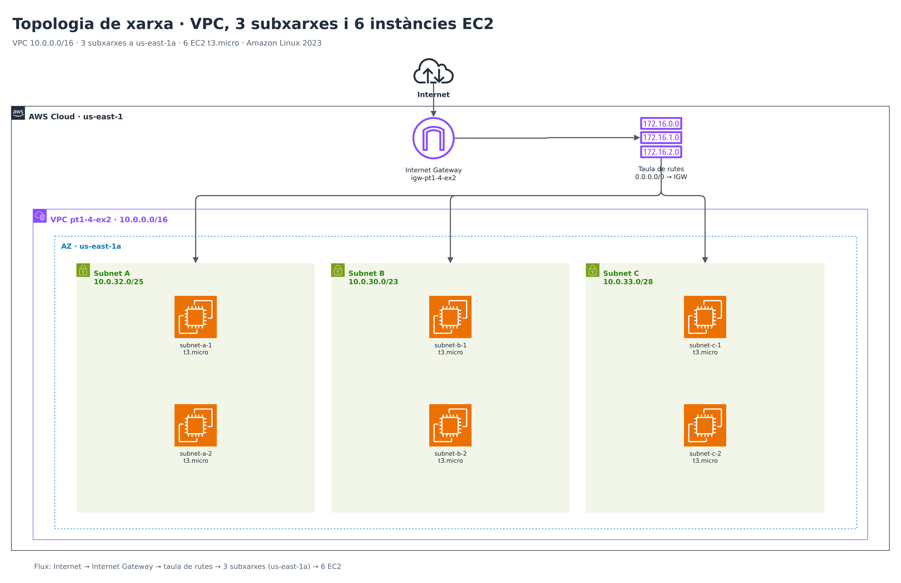

# Exercici 2 — Disseny i desplegament de VPC, subxarxes i EC2

## Objectiu

Entendre la segmentació de xarxes a AWS (VPC i subxarxes) i comparar el
desplegament manual des de la consola d'AWS amb el desplegament automatitzat
mitjançant Terraform.

## Part A — Disseny de la xarxa

### Topologia



El diagrama s'ha dissenyat amb **draw.io** i les formes oficials d'AWS. El fitxer editable és
[`assets/topologia.drawio`](assets/topologia.drawio) i la imatge exportada és
[`assets/topologia.png`](assets/topologia.png).

### Components

| Element | Configuració |
|---|---|
| Regió | `us-east-1` |
| VPC | `10.0.0.0/16` |
| Zona de disponibilitat | `us-east-1a` (les tres subxarxes) |
| Subnet A | `10.0.32.0/25` · 2 instàncies EC2 |
| Subnet B | `10.0.30.0/23` · 2 instàncies EC2 |
| Subnet C | `10.0.33.0/28` · 2 instàncies EC2 |
| Instàncies | 6 en total |
| Tipus d'instància | `t3.micro` |
| Sistema operatiu | Amazon Linux 2023 |

### Planificació d'adreces

| Subxarxa | CIDR | Rang | Adreces | Utilitzables |
|---|---|---|---|---|
| Subnet A | `10.0.32.0/25` | `10.0.32.0` – `10.0.32.127` | 128 | 123 |
| Subnet B | `10.0.30.0/23` | `10.0.30.0` – `10.0.31.255` | 512 | 507 |
| Subnet C | `10.0.33.0/28` | `10.0.33.0` – `10.0.33.15` | 16 | 11 |

Els rangs no se superposen i tots tres queden dins de la VPC `10.0.0.0/16`.
AWS reserva cinc adreces per subxarxa (xarxa, router, DNS, reservada i
broadcast), per això el nombre d'adreces utilitzables és inferior al total.

## Part B — Desplegament manual per consola

Procediment seguit des del panell de control d'AWS:

1. **Crear la VPC** `pt1-4-ex2` amb el rang `10.0.0.0/16`.
2. **Crear les tres subxarxes** a `us-east-1a`:
   - `subnet-a`: `10.0.32.0/25`
   - `subnet-b`: `10.0.30.0/23`
   - `subnet-c`: `10.0.33.0/28`
3. **Llançar sis instàncies EC2** `t3.micro` amb Amazon Linux 2023, dues a
   cadascuna de les subxarxes.
4. **Capturar** la VPC, les subxarxes i el llistat de les sis instàncies en
   execució.

### Captures de pantalla

#### VPC i subxarxes


#### Instàncies EC2


> Un cop fetes les captures, les instàncies creades manualment es van eliminar
> per evitar costos. El desplegament automatitzat de la Part C torna a crear
> la mateixa infraestructura.

## Part C — Desplegament amb Terraform

### Estructura del projecte

```text
practiquescloud/
└── pt1-4-ex2/
    ├── assets/
    │   ├── topologia.drawio
    │   ├── topologia.png
    │   ├── vpc_subnets.png
    │   └── ec2_instances.png
    ├── main.tf
    ├── variables.tf
    ├── outputs.tf
    └── README.md
```

### Requisits

- [Terraform](https://developer.hashicorp.com/terraform/install) `>= 1.6.0`
- Un compte d'AWS amb permisos per crear VPC, subxarxes, Internet Gateway,
  Security Groups i instàncies EC2
- Credencials d'AWS configurades (per exemple, amb `aws configure` o les
  variables `AWS_ACCESS_KEY_ID`, `AWS_SECRET_ACCESS_KEY` i `AWS_REGION`)

### Recursos que crea el codi

| Recurs | Nom | Configuració |
|---|---|---|
| VPC | `pt1-4-ex2-vpc` | `10.0.0.0/16` |
| Subnet A | `pt1-4-ex2-subnet-a` | `10.0.32.0/25` · `us-east-1a` |
| Subnet B | `pt1-4-ex2-subnet-b` | `10.0.30.0/23` · `us-east-1a` |
| Subnet C | `pt1-4-ex2-subnet-c` | `10.0.33.0/28` · `us-east-1a` |
| Internet Gateway | `pt1-4-ex2-igw` | Associat a la VPC |
| Taula de rutes | `pt1-4-ex2-public-rt` | `0.0.0.0/0 → Internet Gateway` |
| Security Group | `pt1-4-ex2-ec2-sg` | Només trànsit de sortida |
| Instàncies EC2 | `pt1-4-ex2-subnet-a-1` … `pt1-4-ex2-subnet-c-2` | 6 × `t3.micro` · Amazon Linux 2023 |

Cada instància s'associa a la subxarxa corresponent mitjançant l'atribut
`subnet_id`. Les tres subxarxes comparteixen la mateixa zona de disponibilitat
(`us-east-1a`) tal com demana l'enunciat.

### Desplegament

Des de la carpeta `pt1-4-ex2`:

```bash
# 1. Inicialitzar el projecte i descarregar el provider d'AWS
terraform init

# 2. Comprovar el format i validar la configuració
terraform fmt -check
terraform validate

# 3. Revisar el pla
terraform plan -out=tfplan

# 4. Aplicar el pla
terraform apply tfplan
```

### Verificació

Consultar els identificadors i les IPs de les instàncies:

```bash
terraform output
terraform output instances
```

L'output `instances` té aquesta forma (els valors són dinàmics i es coneixen
després d'aplicar el pla):

```text
instances = {
  "subnet-a-1" = {
    availability_zone = "us-east-1a"
    id                = "<id-instancia>"
    private_ip        = "<ip-privada>"
    public_ip         = "<ip-publica>"
    subnet_id         = "<id-subnet-a>"
  }
  "subnet-a-2" = { ... }
  "subnet-b-1" = { ... }
  "subnet-b-2" = { ... }
  "subnet-c-1" = { ... }
  "subnet-c-2" = { ... }
}
```

A la consola d'AWS, a **EC2 → Instances**, hi han d'aparèixer les sis
instàncies amb l'etiqueta `Name` corresponent.

### Resultat del desplegament

Desplegament realitzat a `us-east-1` el **28 d'octubre de 2026**:

| Recurs | Identificador |
|---|---|
| VPC | `vpc-0412df319326ec023` |
| Subnet A | `subnet-0d044f6c63b7bdcba` |
| Subnet B | `subnet-0a94717497c696753` |
| Subnet C | `subnet-09726e7fc5d5ebba5` |
| Internet Gateway | `igw-01f73e3081ac36673` |
| Taula de rutes | `rtb-0ea03398e88335f91` |
| Security Group | `sg-0e540d6764d44a4d8` |
| AMI | `ami-04b938437b69a2c9c` (`al2023-ami-2023.12.20261026.1-kernel-6.18-x86_64`) |

| Instància | ID | Subxarxa | IP privada | IP pública |
|---|---|---|---|---|
| `subnet-a-1` | `i-035d023b4cdcc7589` | Subnet A | `10.0.32.99` | `13.222.218.11` |
| `subnet-a-2` | `i-071bd7bd3d34503d8` | Subnet A | `10.0.32.25` | `44.203.251.185` |
| `subnet-b-1` | `i-0be8dc2c1fa8b8737` | Subnet B | `10.0.30.99` | `54.145.161.159` |
| `subnet-b-2` | `i-00b5d0dbd52b2a3bd` | Subnet B | `10.0.30.226` | `3.92.224.127` |
| `subnet-c-1` | `i-09b7c8ffa45606552` | Subnet C | `10.0.33.5` | `44.202.73.65` |
| `subnet-c-2` | `i-083f68c155953cc22` | Subnet C | `10.0.33.8` | `52.90.41.38` |

> Les sis instàncies estan a `us-east-1a`. Les IPs públiques són dinàmiques:
> si es destrueix i es torna a desplegar la infraestructura, canviaran.

#### VPC i subxarxes


#### Instàncies EC2


### Neteja dels recursos

Per evitar costos, eliminar tots els recursos quan s'acabi la pràctica:

```bash
terraform destroy
```

## Comparació: consola vs. Terraform

| Aspecte | Consola d'AWS | Terraform |
|---|---|---|
| Creació | Manual, pas a pas | Descriptiva, amb codi |
| Reproduïbilitat | Depèn dels passos recordats | El mateix codi crea el mateix resultat |
| Revisió prèvia | No hi ha pla | `terraform plan` mostra els canvis |
| Correcció d'errors | Es descobreixen en crear | `terraform validate` i el pla |
| Eliminació | Manual, recurs a recurs | `terraform destroy` |
| Documentació | Captures i notes | El propi codi versionat a Git |


## Autor

Pol Mesquini — pràctica de cloud, curs 2026-2027.
