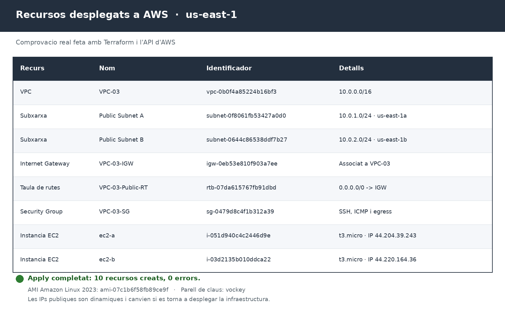

# pt2.2 — Infraestructura bàsica a AWS amb Terraform

## Objectiu

Crear amb Terraform una infraestructura bàsica a AWS formada per una VPC, dues
subxarxes públiques, un Internet Gateway, una taula de rutes, un grup de
seguretat i dues instàncies EC2 Amazon Linux.

## Estructura del repositori

```text
practiquescloud/
└── pt2-2/
    ├── assets/
    │   ├── topologia.png
    │   └── recursos.png
    ├── main.tf
    └── README.md
```

## Topologia


## Requisits

- Terraform `>= 1.6.0`
- Un compte d'AWS amb permisos per crear VPC, subxarxes, Internet Gateway,
  taules de rutes, grups de seguretat i instàncies EC2.
- Credencials d'AWS configurades.
- El parell de claus `vockey` existent a la regió `us-east-1`.

## Recursos que crea el codi

| Recurs | Nom | Configuració |
|---|---|---|
| Provider AWS | — | Regió `us-east-1` |
| VPC | `VPC-03` | `10.0.0.0/16` |
| Subxarxa pública A | `Public Subnet A` | `10.0.1.0/24` · `us-east-1a` · IP pública automàtica |
| Subxarxa pública B | `Public Subnet B` | `10.0.2.0/24` · `us-east-1b` · IP pública automàtica |
| Internet Gateway | `VPC-03-IGW` | Associat a `VPC-03` |
| Taula de rutes | `VPC-03-Public-RT` | `0.0.0.0/0 → Internet Gateway` · associada a les dues subxarxes |
| Grup de seguretat | `VPC-03-SG` | SSH des de `0.0.0.0/0`, ICMP des de `10.0.0.0/16` i tot el trànsit de sortida |
| Instància EC2 | `ec2-a` | `t3.micro` · Amazon Linux · `Public Subnet A` · clau `vockey` |
| Instància EC2 | `ec2-b` | `t3.micro` · Amazon Linux · `Public Subnet B` · clau `vockey` |

## Desplegament

Des de la carpeta `pt2-2`:

```bash
terraform init
terraform fmt -check
terraform validate
terraform plan -out=tfplan
terraform apply tfplan
```

## Verificació

Llistat dels recursos gestionats per Terraform:

```bash
terraform state list
```

```text
data.aws_ami.amazon_linux
aws_instance.ec2_a
aws_instance.ec2_b
aws_internet_gateway.main
aws_route_table.public
aws_route_table_association.public_a
aws_route_table_association.public_b
aws_security_group.main
aws_subnet.public_a
aws_subnet.public_b
aws_vpc.vpc03
```

Resultat real del desplegament a `us-east-1`:



| Recurs | Identificador | Detalls |
|---|---|---|
| VPC | `vpc-0b0f4a85224b16bf3` | `10.0.0.0/16` |
| Public Subnet A | `subnet-0f8061fb53427a0d0` | `10.0.1.0/24` · `us-east-1a` |
| Public Subnet B | `subnet-0644c86538ddf7b27` | `10.0.2.0/24` · `us-east-1b` |
| Internet Gateway | `igw-0eb53e810f903a7ee` | Associat a la VPC |
| Taula de rutes | `rtb-07da615767fb91dbd` | `0.0.0.0/0 → IGW` |
| Grup de seguretat | `sg-0479d8c4f1b312a39` | SSH, ICMP i egress |
| Instància `ec2-a` | `i-051d940c4c2446d9e` | `t3.micro` · `10.0.1.243` · `44.204.39.243` |
| Instància `ec2-b` | `i-03d2135b010ddca22` | `t3.micro` · `10.0.2.81` · `44.220.164.36` |

Les dues instàncies estan en execució, cadascuna en una subxarxa diferent, amb
la clau `vockey` i les etiquetes `ec2-a` i `ec2-b`.

